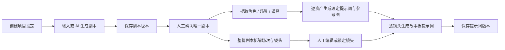
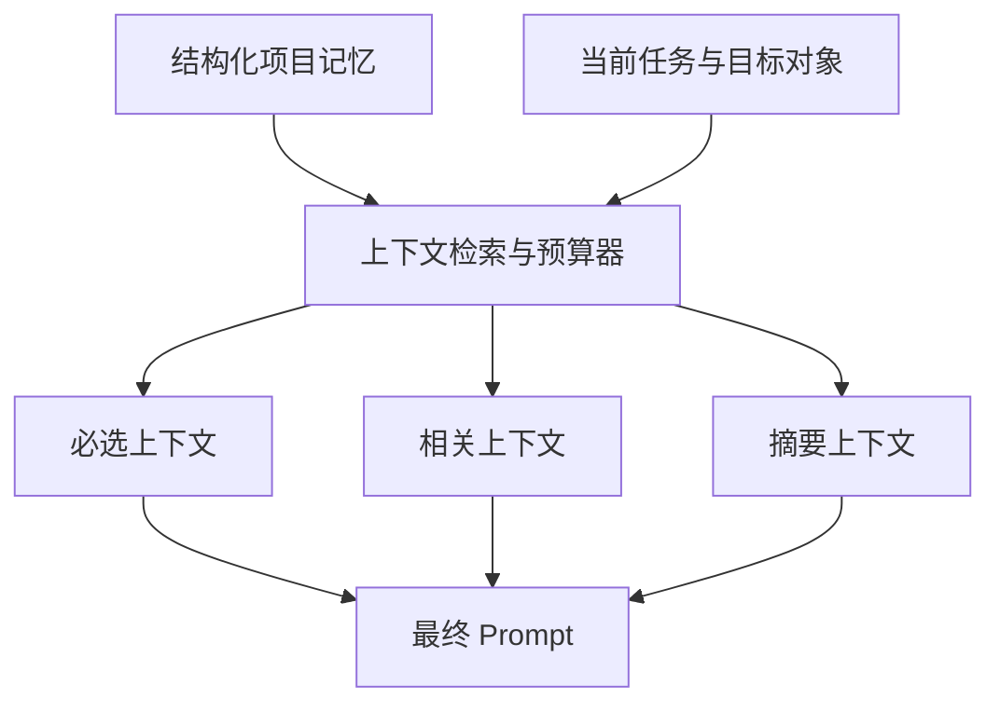

# FilmAgent：量化指标、运行逻辑与上下文窗口讨论稿

> 本文基于当前仓库代码梳理。为了方便一起迭代，内容明确区分：**当前已实现**、**可直接计算**、**建议新增**。它不是最终架构结论，而是一份可用于产品和技术讨论的基线。

## 实施进展（2026-07-02）

第一阶段分镜校验与 Agent 评估窗口已经实现：

- 每次分镜生成记录为一条 `agent_runs`，区分通过、校验失败、请求失败和重复生成。
- 新结果必须通过场次连续编号、镜头连续编号、剧本引用覆盖率、引用匹配率和重复镜头检查。
- 当前硬门槛为：引用覆盖率不低于 80%，引用匹配率不低于 70%，其余检查必须完全通过。
- 未通过校验的新分镜不会覆盖已有分镜。
- 项目新增“Agent 评估”窗口，展示总体通过率、重复生成次数、两类失败数、逐项通过率和最近运行。
- 当前指标只覆盖分镜生成；剧本、资产和提示词生成仍属于后续扩展范围。

## 1. 一句话判断

当前 FilmAgent 更准确地说是一个“由数据库状态驱动的 AI 影视生产流水线”，而不是持续对话、持续记忆的 Agent。

- 长期上下文保存在 SQLite 的项目、剧本版本、资产、场次、镜头和提示词版本中。
- 每次调用模型都是独立请求，只临时组装本步骤需要的数据。
- 当前没有聊天历史、会话记忆、token 计数、上下文预算、自动摘要或超限裁剪。
- 因而短项目简单可靠；剧本、资产目录变大后，会面临上下文超限、成本不可见和跨镜头一致性不足。

## 2. 当前实际运行逻辑

### 2.1 主流程



项目状态依次包含：`DRAFT_SCRIPT`、`SCRIPT_REVIEW`、`SCRIPT_APPROVED`、`ASSET_REVIEW`、`SHOT_LIST_REVIEW`、`PROMPT_REVIEW`、`COMPLETED`。不过当前代码中确认剧本后直接进入 `ASSET_REVIEW`，还没有写入 `SCRIPT_APPROVED`；`COMPLETED` 也没有实际迁移入口。因此状态枚举比实际状态机更完整。

### 2.2 五类模型调用及其上下文

| 调用 | 输入给模型的实际上下文 | 输出 | 当前风险 |
|---|---|---|---|
| 生成剧本 | 标题、语言、故事梗概、额外要求、世界设定 | 完整剧本文本 | 输入通常较小，但输出固定上限可能截断长剧本 |
| 提取资产 | 视觉风格、世界设定、**完整已确认剧本**、JSON Schema | 资产列表 | 长剧本会膨胀；结构验证失败只做模型级重试 |
| 生成分镜 | 风格、画幅、语言、世界设定、**完整已确认剧本**、JSON Schema | 全部场次和镜头 | 当前最容易超过窗口；一次失败意味着整篇重做 |
| 生成资产提示词 | 单个资产、项目风格、世界设定、版式要求 | 单条资产提示词 | 上下文小、隔离好，但不感知同类资产，可能风格漂移 |
| 生成镜头提示词 | 单个镜头字段、项目设定、**项目全部资产目录及其完整提示词** | 单条正/负提示词 | 资产越多，每个镜头都重复携带大量无关上下文 |

模型请求固定为两条消息：一条 `system` 和一条 `user`。没有把上一次模型回复带入下一次请求，也没有会话 ID。

### 2.3 数据持久化与覆盖语义

- 剧本是追加版本：同一项目按 `version + 1` 保存，确认某版时取消其他版本的确认状态。
- 分镜不是追加版本：重新生成时会删除该项目已有全部场次，再写入新结果；连带删除旧镜头及其提示词。
- 镜头提示词是追加版本：同一镜头每次生成都会保存新版本。
- 资产提取是合并写入：按“类型 + 规范化名称”去重；已有资产只在描述为空时补描述，不删除旧资产。
- 资产图片有生成状态：`pending → generating → ready / failed`，后台任务执行并由前端轮询。
- `is_locked` 当前只被保存和展示；重新生成整套分镜时并不会保护已锁定镜头。

这意味着当前最重要的数据风险是：用户以为“锁定”代表不会被重生成覆盖，但实际重新生成分镜会删除它。

## 3. 当前代码中已有的量化约束

这些是已经生效的硬指标，而不是建议值：

| 指标 | 当前值或规则 |
|---|---|
| DeepSeek 最大输出 | `max_tokens = 8192` |
| DeepSeek 超时 | 默认 120 秒 |
| JSON 解析尝试 | 最多 2 次；仅 JSON 调用重试 |
| 图片生成超时 | 默认 300 秒 |
| 上传图片大小 | 1 byte 至 10 MB |
| 剧本版本 | 每项目单调递增 |
| 提示词版本 | 每镜头单调递增 |
| 场次序号 | 每项目唯一 |
| 镜头序号 | 每场次唯一；删除后重新连续编号 |
| 资产名称 | 每项目唯一；另有应用层规范化去重 |
| 镜头提示词批处理 | 前端逐镜头串行调用 |
| 资产提示词批处理 | 前端逐资产串行调用 |

注意：`max_tokens = 8192` 是**输出上限**，不是完整上下文窗口，也没有限制输入长度。代码目前不知道具体模型的窗口大小，更不会提前阻止或拆分超长输入。

## 4. 当前真正能计算、但尚未形成仪表盘的产品指标

不改数据库或只做简单查询就能得到：

- 项目漏斗：各状态项目数和状态停留时间。
- 创作规模：每项目剧本版本数、字数、场次数、镜头数、资产数。
- 人工迭代：剧本版本数、镜头编辑数（目前缺编辑事件，只能看最终值）、每镜头提示词版本数。
- 资产覆盖：有提示词资产占比、有主参考图资产占比、图片成功/失败占比。
- 生产完整度：已生成提示词镜头数 / 总镜头数。
- 结构密度：镜头/场次、角色/镜头、场景/镜头、平均提示词长度。
- 图片任务：按 provider/model 的成功率、失败率与生成耗时；但当前没有记录开始时间和完成时间，耗时只能粗略估算或无法准确得到。

一个适合首页的最小“项目健康度”可以先定义为：

```text
项目完整度 = 20% × 剧本已确认
           + 20% × 资产描述覆盖率
           + 20% × 资产参考图覆盖率
           + 20% × 分镜字段完整率
           + 20% × 镜头提示词覆盖率
```

这只是流程完整度，不等于创作质量；二者不应混成一个分数。

## 5. 建议新增的核心指标

### 5.1 模型运行与成本

每次模型调用建议记录一条 `model_runs`：

- `operation`：script / asset_extract / storyboard / asset_prompt / shot_prompt。
- `provider`、`model`、`request_id`。
- `input_tokens`、`output_tokens`、`cached_tokens`（供应商提供时）。
- `latency_ms`、`status`、`error_type`、`attempt_count`。
- `estimated_cost`，以及关联的 project/script/scene/shot/asset ID。
- `prompt_template_version` 与输出 schema 版本。

由此得到四个首要 SLI：成功率、P50/P95 延迟、每项目 token/成本、结构化输出一次通过率。

### 5.2 影视生成质量

建议先用可解释、可抽查的指标，避免一个神秘的“AI 总分”：

- **剧本覆盖率**：有 `script_reference` 的镜头数 / 总镜头数。
- **资产引用召回率**：镜头文本中出现的已知资产，被 `@资产名` 引用的比例。
- **资产引用精确率**：提示词中引用的资产，是否真实属于该项目且与镜头有关。
- **连续性完整率**：非首镜头中 `continuity` 非空的比例。
- **结构合法率**：通过 Pydantic/业务规则校验的输出比例。
- **序号合法率**：场次与镜头是否从 1 连续递增且无重复。
- **人工接受率**：生成后未编辑直接采用的比例；需要新增 revision/event 记录才能准确计算。
- **重生成率**：同一对象 24 小时内再次生成的比例，可作为“不满意”的弱信号。
- **锁定保留率**：重生成后锁定镜头保持不变的比例；目标应为 100%。

### 5.3 一致性指标

影视工作流的核心不是单条提示词漂亮，而是跨镜头一致：

- 同一角色在所有相关镜头中的资产引用覆盖率。
- 同一场次的地点、时段、服装、关键道具冲突数。
- 相邻镜头的轴线、光线、人物位置等连续性冲突数。
- 项目视觉风格词在资产和镜头提示词中的继承率。

这些指标适合分成“规则检查 + LLM 评审”两层。规则检查可稳定、低成本运行；LLM 评审只处理规则无法判断的语义冲突，并保存评审理由，而不只保存分数。

## 6. 用户上下文窗口：当前机制

这里需要区分三种“上下文”：

1. **用户会话上下文**：当前不存在。前端没有聊天消息历史，后端没有 conversation/message 表。
2. **项目长期上下文**：存在于 SQLite，包括项目设定、已确认剧本、资产、镜头和历史版本。
3. **单次模型上下文**：由 `workflow.py` 针对每个动作即时拼接；请求结束即消失。

当前的上下文选择策略可以概括为：

```text
生成分镜 = 项目设定 + 完整剧本
提取资产 = 项目设定 + 完整剧本
生成镜头提示词 = 项目设定 + 单个镜头 + 全部资产
```

它的优点是确定、容易调试、没有对话历史污染；缺点是随项目规模线性膨胀，并且既会“带太多”（全资产目录），也会“带太少”（缺少相邻镜头、当前场次和前序连续性状态）。

## 7. 建议的上下文架构

### 7.1 不要把聊天记录直接当记忆

建议继续以数据库中的结构化事实作为主记忆，把自然语言对话视为“产生修改意图的入口”。真正写入长期上下文的应是确认后的事实，例如：

- 世界观圣经：时代、地域、规则、视觉禁忌。
- 角色圣经：稳定外观、服装状态、关系和别名。
- 场景圣经：空间结构、光线基线、可用机位。
- 连续性状态：每场戏开始/结束时人物、服装、道具、时间状态。
- 用户偏好：画幅、镜头节奏、禁用词、目标图片模型。

### 7.2 每类任务使用不同的上下文包



- 分镜拆解：按场景/段落分块剧本，携带项目圣经和前一块摘要，最后做全局序号与连续性校验。
- 镜头提示词：只带当前场次、当前镜头、前后相邻镜头、被命中的资产，而不是全部资产。
- 资产提示词：带同类型资产的简短风格约束或公共 visual bible，减少角色之间的画风漂移。
- 用户修改：优先读取目标对象和依赖对象，不把全部历史聊天塞进窗口。

### 7.3 建立明确 token 预算

预算应由模型能力配置，而不是写死一个模糊阈值：

```text
可用输入预算 = 模型上下文窗口
             - 预留输出 token
             - system/schema token
             - 安全余量
```

一个可讨论的初版分配是：必选事实 40%、当前原文 35%、检索内容 15%、历史摘要 10%。超限时依次丢弃低相关检索、压缩历史摘要、缩短资产描述；不能裁掉 JSON Schema、用户当前指令和连续性硬约束。

### 7.4 长剧本应采用分块 + 汇总，而不是硬截断

建议流程：

1. 按场景标题或剧本段落切块，不按字符数生切。
2. 每块提取局部场次、镜头、资产和连续性状态。
3. 将上一块的“结束状态”传给下一块。
4. 合并后做资产归一化、序号整理、重复镜头检测。
5. 运行一次全局连续性审查，只返回差异或修补建议。

这会增加调用次数，但能把失败从“整篇失败”缩小为“单块可重试”，也方便显示真实进度。

## 8. 推荐的实施顺序

### P0：先让系统可观测、不会悄悄损坏用户成果

- 新增 `model_runs`，记录 token、耗时、错误、重试、模型和模板版本。
- 调用前估算 token，并对超预算请求明确报错；不要依赖供应商截断。
- 修正锁定语义：重生成时保留锁定镜头，或在 UI 中明确锁定仅供标记。
- 分镜重生成前保留版本/快照，而不是直接删除唯一一套结果。
- 将上游请求错误、解析错误、schema 错误分开统计。

### P1：降低上下文浪费并提高一致性

- 镜头提示词只检索相关资产，并加入当前场次和相邻镜头。
- 将完整剧本分块处理，增加块级重试和最终合并校验。
- 为项目新增 visual bible 与 continuity state。
- 把 prompt/schema 写上版本号，确保指标可以按版本比较。

### P2：形成质量闭环

- 记录用户编辑 diff、采用、撤销和重生成事件。
- 上线规则型质量检查，再增加带理由的 LLM 评审。
- 做项目健康面板：完整度、连续性风险、成本、失败率和待人工确认项。

## 9. 我们接下来最值得一起决定的问题

1. FilmAgent 的核心目标是“更快产出”，还是“跨几十/几百镜头的一致性”？这会影响成本和上下文优先级。
2. 用户修改是继续通过表单完成，还是要加入真正的对话入口？如果加入，对话应修改结构化数据，而不是成为第二套事实源。
3. 分镜重生成应该按全片、场次还是选中镜头进行？我倾向于以场次为默认重生成单元。
4. 锁定对象需要锁定哪些层级：镜头字段、提示词、资产、参考图，还是整场戏？
5. 质量评价由用户行为驱动，还是先定义一套影视规则评分？建议两者并存，但将用户最终采用视为更强信号。
6. 成本目标是什么：单项目预算、单镜头预算，还是优先质量不设硬上限？没有这一点，上下文预算只能做技术最优，无法做产品最优。

## 10. 当前结论

项目的结构化数据模型已经具备成为“长期记忆”的良好基础，当前短板不在于缺一个更长的聊天窗口，而在于缺少上下文选择器、token/成本观测、可恢复的分块执行，以及跨镜头连续性状态。

我建议下一步先实现 P0 的 `model_runs + token 预算 + 分镜版本保护`。这三件事会让后续所有有关质量、成本和上下文的讨论都有真实数据，而不是凭感觉调 prompt。
